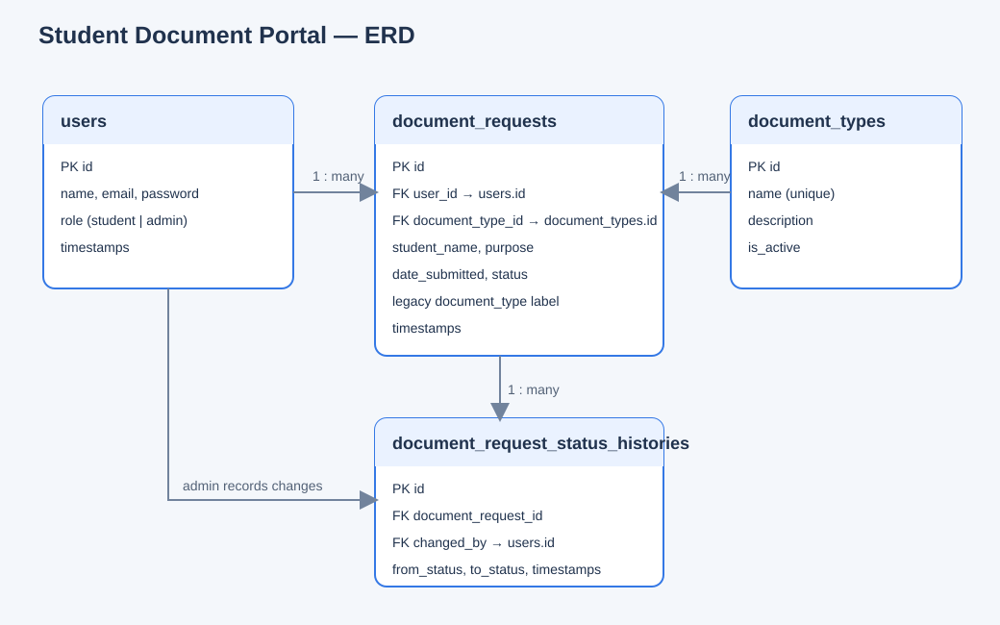

# Student Document Portal

**Student:** Replace with your name  
**Client:** Replace with the approved school office/client  
**Theme:** Student requests for official school documents, with staff processing and status tracking.

## Problem and solution

The portal replaces informal document requests with a single place for students to submit and track requests, and for authorized school staff to process them. Students can create and edit their own requests; administrators manage document types, review requests, change workflow status, and delete requests.

> Complete this description with your approved client problem statement and proposal details before submission.

## Features

- Sanctum token registration, login, current-user lookup, logout, and persisted client authentication.
- Student and administrator roles enforced by the API; admin-only actions are also hidden from student navigation.
- CRUD endpoints for document requests and document types, with ownership checks and related Eloquent models.
- Search, status filtering, and API pagination for requests.
- Dashboard summary counts from the database.
- Client and server validation with field-level API validation feedback.
- Pending → Approved → Processing → Ready for Release → Completed workflow with status history.
- Loading, empty, success, and error states, plus confirmation before deletion.
- Responsive React SPA with protected routes, reusable controls, and phone-screen layout.

## Stack

- React 19, Vite, React Router, Axios, plain responsive CSS
- Laravel 12, PHP 8.2+, Laravel Sanctum API tokens
- MySQL / MariaDB

## Setup from a fresh clone

Install PHP 8.2+, Composer, Node.js/npm, and MySQL/MariaDB. Create a database named `student_document_portal`, then configure the environment files:

### Backend

```powershell
cd backend
composer install
Copy-Item .env.example .env
```

Edit `backend/.env` with your local MySQL credentials, then run:

```powershell
php artisan key:generate
php artisan migrate --seed
php artisan serve
```

The API is served at `http://127.0.0.1:8000/api`. For a clean local database, use `php artisan migrate:fresh --seed`; this deletes existing tables/data.

### Frontend

In a second terminal:

```powershell
cd frontend
Copy-Item .env.example .env
npm install
npm run dev
```

The Vite app is served at `http://127.0.0.1:5173`. Set `VITE_API_URL` in `frontend/.env` if the API runs at a different URL. Local dev and preview origins are allowed by default. For deployment, set `CORS_ALLOWED_ORIGINS` in `backend/.env` to the exact frontend origin(s), and configure the frontend host to rewrite app paths (such as `/requests/new`) to `index.html` for browser refreshes.

## Local demo accounts

| Role | Email | Password |
|---|---|---|
| Administrator | `admin@school.test` | `AdminPass123!` |
| Student | `student@school.test` | `StudentPass123!` |

These accounts and sample records are created by `php artisan db:seed`. Use only for local demonstrations; do not use the demo passwords in a deployment.

## API documentation

All routes below use the `/api` prefix. Except registration and login, routes require `Authorization: Bearer <token>` and `Accept: application/json`. Student request listing is limited to their own records; administrators can manage all requests.

| Method | Endpoint | Access | Purpose |
|---|---|---|---|
| POST | `/register` | Public | Create a student account and return a Sanctum token |
| POST | `/login` | Public, rate-limited | Authenticate and return a token |
| POST | `/logout` | Authenticated | Revoke the current token |
| GET | `/user` | Authenticated | Return the current user and role |
| GET | `/dashboard` | Authenticated | Return role-scoped summary counts |
| GET | `/document-requests?search=&status=&document_type_id=&page=&per_page=` | Authenticated | List/filter requests with Laravel pagination |
| POST | `/document-requests` | Authenticated | Create a Pending request for the current user |
| GET | `/document-requests/{id}` | Owner/admin | View one request |
| PUT/PATCH | `/document-requests/{id}` | Owner/admin | Edit request details |
| PATCH | `/document-requests/{id}/status` | Admin | Change workflow status and record history |
| DELETE | `/document-requests/{id}` | Admin | Delete a request |
| GET | `/document-types` | Authenticated | List active types (admins also see inactive types) |
| POST | `/document-types` | Admin | Create a document type |
| GET | `/document-types/{id}` | Authenticated | View an active type |
| PUT/PATCH | `/document-types/{id}` | Admin | Update a type |
| DELETE | `/document-types/{id}` | Admin | Delete an unused type |

Validation failures return HTTP 422 with an `errors` object. Unauthorized requests return 401; denied role/ownership actions return 403. Paginated request responses include `data`, `links`, and `meta`.

## Data model



There are three related business tables besides users: `document_types`, `document_requests`, and `document_request_status_histories`. Foreign keys and Eloquent relationships connect users, types, requests, and status-history entries.

## Testing

Backend:

```powershell
cd backend
php artisan test
```

Frontend:

```powershell
cd frontend
npm run lint
npm run build
```

The API feature tests use an in-memory SQLite database. Normal application setup uses MySQL/MariaDB as required by the capstone.

## Submission items to complete

- Replace the student/client placeholders above with the approved proposal details.
- Add your approved proposal, wireframes, and any required client approval evidence.
- Add screenshots, presentation slides, and a 5–8 minute demo video in the requested docs locations; create these from your own running demo rather than using placeholders.
- Create the GitHub repository, add the instructor as collaborator, and maintain the required commit history.

## References

- Laravel and Sanctum documentation
- React, React Router, and Axios documentation
- AI coding assistance (Copilot) was used during implementation; review and explain the code as your own work before submission.
